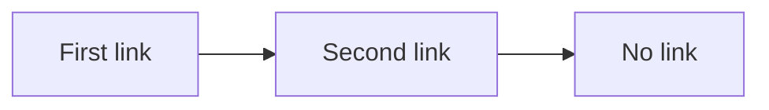
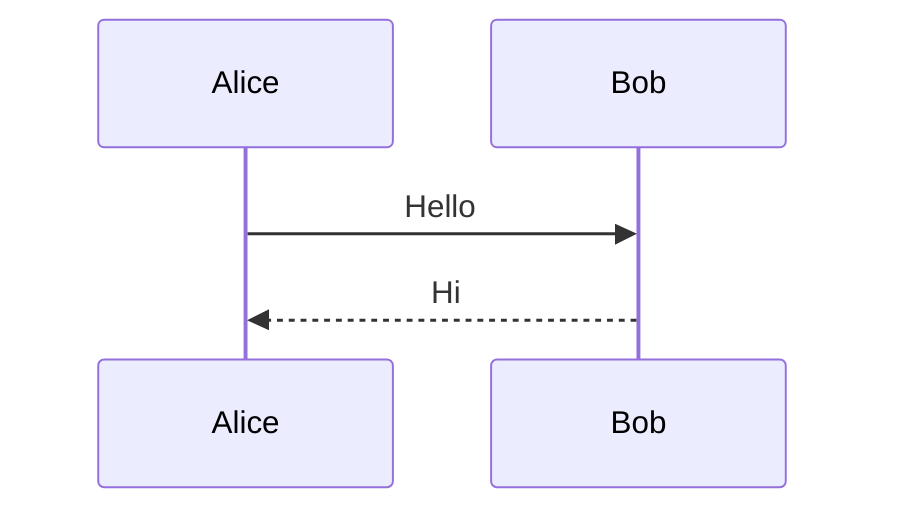
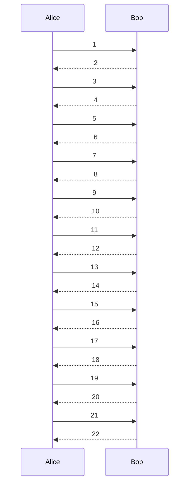

# Diagram keyboard walk

A [plain link](https://example.com/before) before the diagrams.

## Flowchart with two links

A [plain link](https://example.com/between) between the diagrams.

## Sequence diagram with actor menus

## Taller than the window

A [plain link](https://example.com/after) after the diagrams.
